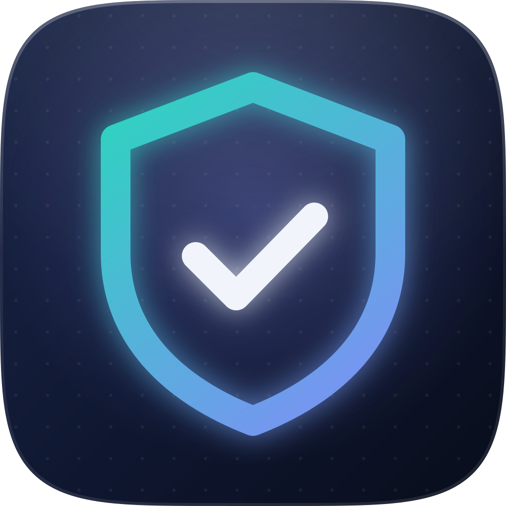

  <picture>
    <source media="(prefers-color-scheme: dark)" srcset="assets/banner-dark.svg">
    
  </picture>

<h3 align="center">Automated trading on Solana, built evidence first.</h3>

  Pulse records on-chain activity, studies what it records, and trades only the strategies that passed their gates, inside hard limits.

   
  <b>Evidence first</b> 
  Every idea is written down before it's tested. A strategy trades only after it passes its gates.

   
  <b>Hard limits</b> 
  Every limit lives in versioned settings, never in code. Three guards stand before the chain, and each refuses rather than guesses.

   
  <b>Only code trades</b> 
  Agents research and build. They never hold keys or place orders.

### The lines

Pulse never crosses these, in code or in research.

- **No market manipulation:** no wash volume, no bundled buys, no coordinated pumps.
- **No front-running** or sandwiching anyone's pending trades.
- **Public information only.** Nothing others can't see or buy.
- **No copy-trading,** and no following insiders.

 

  

  The code is private. Pulse has no token, never asks anyone for money, keys or seed phrases, and doesn't answer messages sent through this page.

